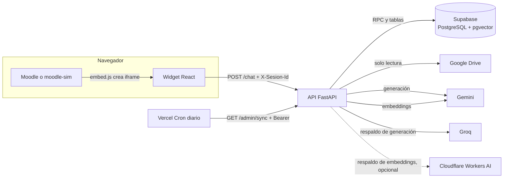
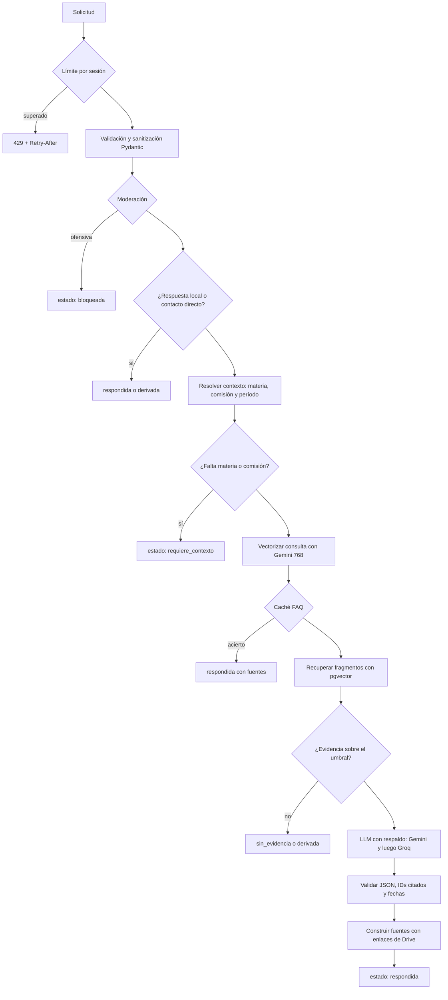
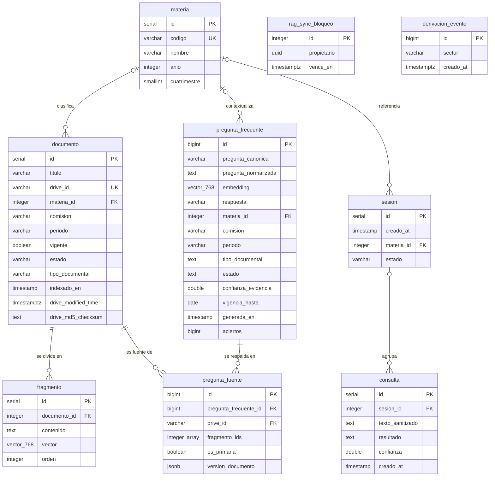

# Manual Técnico: Asistente Virtual del IFTS N.° 29

Este manual está dirigido a desarrolladores que necesiten instalar, mantener o continuar el desarrollo del asistente. Describe cómo está construido el sistema, qué componentes lo integran y cómo reproducir el entorno de trabajo y el despliegue.

El manual se basa en el código de la rama `develop`. Cuando un tema ya está documentado en detalle en `docs/`, se resume y se enlaza al documento correspondiente.

## Índice

1. [Introducción general](#1-introducción-general)
2. [Arquitectura del sistema](#2-arquitectura-del-sistema)
3. [Estructura del proyecto](#3-estructura-del-proyecto)
4. [Base de datos](#4-base-de-datos)
5. [Configuración e instalación](#5-configuración-e-instalación)
6. [Componentes principales](#6-componentes-principales)
7. [Gestión de errores y validaciones](#7-gestión-de-errores-y-validaciones)
8. [Pruebas implementadas](#8-pruebas-implementadas)
9. [Observaciones y deuda técnica](#9-observaciones-y-deuda-técnica)
10. [Documentación relacionada](#10-documentación-relacionada)

---

## 1. Introducción general

### Descripción

El Asistente Virtual del IFTS N.° 29 es un chatbot que responde consultas de estudiantes a partir de la documentación institucional publicada en una carpeta de Google Drive: programas de materias, cronogramas y documentos generales. Se muestra dentro del campus Moodle como un widget embebido en un `<iframe>`.

El sistema funciona con la técnica de **generación aumentada por recuperación** (RAG, por *Retrieval-Augmented Generation*):

1. Los documentos de Drive se descargan, se dividen en fragmentos y cada fragmento se convierte en un vector (*embedding*) que se guarda en Supabase (PostgreSQL con `pgvector`).
2. Ante una consulta, se vectoriza el texto, se buscan los fragmentos más parecidos y, si superan un umbral de confianza, se le pide a un modelo de lenguaje (LLM) que redacte una respuesta **usando solo esos fragmentos**.
3. La respuesta se valida antes de devolverla: los fragmentos citados tienen que existir y las fechas tienen que figurar en la fuente. Se acompaña con enlaces a los documentos originales.

### Objetivo

Facilitar el acceso a la información académica e institucional sin inventar datos. Si no hay evidencia suficiente, el asistente lo dice y deriva la consulta al sector que corresponde (Bedelía, Secretaría Académica, etc.).

### Alcance

Incluido:

- Consultas sobre las cuatro materias cargadas en la base: Técnicas de Programación, Administración de Base de Datos, Elementos de Análisis Matemático y Lógica Computacional.
- Tres tipos de documento: `programa`, `cronograma` y `general`, con filtros por materia, comisión y período.
- Pedido de contexto: si la consulta necesita materia o comisión y no las indica, el asistente las pregunta.
- Derivación a sectores institucionales con un correo prearmado, sin datos de la persona.
- Moderación de lenguaje ofensivo y ocultación de datos personales (DNI, CUIL, correo, teléfono y nombre).
- Caché de preguntas frecuentes curadas (FAQ).
- Sincronización incremental y diaria con Drive.
- Widget embebible en Moodle, en modo flotante o incrustado.

Fuera de alcance:

- Usuarios, inicio de sesión o historial de conversaciones. El asistente no guarda los mensajes (RNF01).
- Escritura en Drive. El acceso es de solo lectura.
- Panel de administración visual. La administración es una única ruta protegida con token.

---

## 2. Arquitectura del sistema

### Modelo general

El sistema tiene **tres aplicaciones independientes** que se despliegan por separado en Vercel y se comunican por HTTP.

| Aplicación | Carpeta | Tecnología | Función |
|---|---|---|---|
| API | `backend/` | Python 3.12 + FastAPI | Orquesta la conversación, el RAG, la sincronización y la administración |
| Widget | `frontend/widget/` | React 19 + TypeScript + Vite | Interfaz del chat que se embebe en Moodle |
| moodle-sim | `frontend/moodle-sim/` | TypeScript + Vite | Aula simulada de Moodle, solo para probar el embebido |

El **backend** sigue una **arquitectura por capas**, con módulos de responsabilidad única dentro de cada capa:

```text
routers/     Capa de presentación HTTP: rutas, dependencias y códigos de estado.
   │
services/    Capa de lógica de negocio: orquestación, recuperación, validaciones y reglas.
   │
db/ drive/ providers/
             Capa de acceso a datos y a servicios externos: Supabase, Google Drive y LLM/embeddings.

models/      Contratos Pydantic que comparten todas las capas.
settings.py  Configuración validada a partir de variables de entorno.
```

Decisiones de diseño que se repiten en todo el código:

- **Inyección de dependencias.** Los gestores de LLM y de embeddings, la configuración y el contador de solicitudes se obtienen con `Depends(...)` de FastAPI y se reemplazan en las pruebas.
- **Proveedores intercambiables.** Cada proveedor implementa una interfaz abstracta (`ProveedorLLM` y `ProveedorEmbeddings`). Un gestor los prueba en orden y pasa al respaldo si uno falla.
- **Configuración y catálogos fuera del código.** Los sectores de derivación, las comisiones, la moderación y los mensajes están en archivos JSON de `backend/app/config/`.
- **Sin estado persistente de conversación.** El contexto (materia, comisión, período y consulta pendiente) viaja en cada solicitud y respuesta.

El **widget** se organiza por componentes React y separa el cliente de la API (`api/`), el estado de la conversación (`hooks/useConversacion.ts`), la configuración (`config/`) y la integración con la página contenedora (`embebido/`).

### Diagrama de componentes



### Flujo de una consulta (`POST /chat`)



### Tecnologías empleadas

| Área | Tecnología | Uso |
|---|---|---|
| Lenguaje del backend | Python 3.12 | Toda la API |
| Framework web | FastAPI 0.143 + Uvicorn 0.54 | Rutas, validación y documentación OpenAPI en `/docs` |
| Validación y configuración | Pydantic y `pydantic-settings` 2.15 | Contratos y lectura de variables de entorno |
| Cliente HTTP | `httpx` 0.28 | Llamadas a Gemini, Groq y Cloudflare |
| Base de datos | Supabase (PostgreSQL + `pgvector`), cliente `supabase` 2.31 | Documentos, fragmentos, vectores y FAQ |
| Documentos | Google Drive API v3 (`google-api-python-client`) | Lectura de la carpeta institucional |
| Extracción de texto | `pypdf` y `python-docx` | PDF, DOCX y Google Docs exportados |
| Fragmentación | `langchain-text-splitters` | Fragmentos de 1000 caracteres con 200 de solapamiento |
| Texto | `unidecode` y `thefuzz` | Normalización y coincidencia aproximada |
| LLM | Gemini (principal) y Groq (respaldo) | Redacción de respuestas |
| Embeddings | Gemini `gemini-embedding-001` (768) y Cloudflare `@cf/baai/bge-m3` (respaldo) | Vectorización |
| Frontend | React 19, TypeScript 6 y Vite 8 | Widget y moodle-sim |
| Calidad | `pytest`, `pytest-cov` y `ruff`; ESLint y Prettier | Pruebas, lint y formato |
| Despliegue | Vercel (plan Hobby) | Tres proyectos y el cron diario |
| Control de versiones | Git y GitHub | Ramas `main`, `develop` y `feature/*` |

---

## 3. Estructura del proyecto

```text
chatbot-ifts-29/
├── .github/
│   ├── workflows/ci.yml          CI (ver sección 9)
│   └── pull_request_template.md
├── backend/
│   ├── app/                      Código de la API
│   ├── migrations/               Scripts SQL 0001 a 0009 (aplicación manual)
│   ├── scripts/                  CLI de operación y scripts de prueba manual
│   ├── tests/                    Pruebas unitarias, de integración y SQL
│   ├── examples/                 Preguntas frecuentes curadas, de ejemplo
│   ├── probar_drive.py           Prueba manual de conexión con Drive
│   ├── pyproject.toml            Dependencias para Vercel, ruff y pytest
│   ├── requirements.txt          Dependencias de producción (pip local)
│   ├── requirements-dev.txt      Más pytest, pytest-cov y ruff
│   ├── .python-version           3.12
│   ├── .env.example              Plantilla documentada de variables
│   └── vercel.json               Cron diario de /admin/sync
├── frontend/
│   ├── widget/                   Widget React
│   └── moodle-sim/               Simulación de Moodle
├── docs/                         Documentación técnica complementaria
│   ├── diseno/                   Capturas del diseño
│   └── manuales/                 Este manual
├── README.md
└── LICENSE
```

### Backend: `backend/app/`

| Carpeta o archivo | Contenido |
|---|---|
| `main.py` | `crear_app()`: crea la instancia de FastAPI, registra CORS y los routers. `app` es el objeto que cargan Uvicorn y Vercel (`app.main:app`). |
| `settings.py` | Clase `Configuracion` (`pydantic-settings`), que lee y valida todas las variables de entorno. `obtener_configuracion()` la guarda en caché por proceso. |
| `routers/` | `health.py` (`GET /health`), `chat.py` (`POST /chat`) y `admin.py` (`GET`/`POST /admin/sync`). |
| `services/` | Lógica de negocio. Los módulos se describen en la [sección 6](#6-componentes-principales). |
| `db/` | Acceso a Supabase: `conexion.py` (cliente), `repositorio.py` (documentos, fragmentos, materias, búsqueda vectorial y bloqueo), `faq.py` (caché FAQ) y `derivaciones.py` (registro anónimo de derivaciones). |
| `drive/` | `cliente.py` (conexión de solo lectura, listado, metadatos y descarga), `extractores.py` (texto de PDF y DOCX) y `convencion.py` (lector de rutas heredado, ver sección 9). |
| `providers/` | LLM: `base.py` (contrato y errores), `_http.py` (base HTTP común), `gemini.py`, `groq.py`, `gestor.py` (respaldo y reintentos), `dependencias.py` (construcción desde la configuración), `formato.py` y `falso.py` (doble de prueba). |
| `providers/embeddings/` | Igual que el anterior, para embeddings: `base.py`, `_http.py`, `gemini.py`, `cloudflare.py`, `gestor.py`, `dependencias.py` y `falso.py`. |
| `models/` | Contratos Pydantic: `chat.py` (solicitud y respuesta pública, salida del generador), `rag.py` (indexación y recuperación) y `faq.py` (caché FAQ). |
| `prompts/sistema.md` | Instrucciones de sistema del LLM: responder solo con evidencia y devolver un JSON con `respuesta`, `fragmento_ids` y `citas_textuales`. |
| `config/` | Catálogos JSON: `derivaciones.json` (sectores), `comisiones.json` (períodos y comisiones válidos), `moderacion.json` (vocabulario bloqueado, ver `README_moderacion.md`) y `messages.json` con `message_loader.py`. |

### Backend: `backend/scripts/`

| Script | Uso |
|---|---|
| `sincronizar_drive.py` | `ejecutar [--forzar]`: sincroniza Drive con la base. `validar-nombres`: solo revisa los nombres de archivo. `verificar --documento-id N --consulta "..."`: comprueba la recuperación de un documento. |
| `cargar_faq.py` | `cargar --archivo <json>`: genera y guarda FAQ curadas. `regenerar [--limite N] [--presupuesto-segundos S]`: procesa las FAQ pendientes. |
| `probar_rag.py` | Pruebas manuales de recuperación y `reindexar` de un documento, con `--dry-run`, `--aplicar` o `--verificar`. |
| `probar_llm.py` | Llamada manual a los proveedores LLM (`--consulta`, `--contexto`, `--instrucciones`). |
| `test_cron.py`, `test_derivacion.py`, `test_local.py` | Scripts manuales de prueba. pytest no los ejecuta. |

Todos los scripts se ejecutan desde `backend/` y usan la configuración del `.env`. **Escriben en la base real o consumen cuota de los proveedores**, así que hay que coordinar con el equipo antes de usarlos contra producción.

### Frontend: `frontend/widget/`

| Ruta | Contenido |
|---|---|
| `public/embed.js` | Script que se pega en Moodle. Crea el `<iframe>` flotante y ajusta su tamaño cuando el widget avisa por `postMessage`. |
| `src/main.tsx` y `src/App.tsx` | Punto de entrada. `App` elige `WidgetFlotante` o `WidgetIncrustado` según `?modo=`. |
| `src/api/` | `cliente.ts` (interfaz `ClienteChat`), `clienteReal.ts` (`fetch` a `POST /chat` con tiempos límite), `clienteMock.ts` (respuestas simuladas), `tipos.ts` (contrato espejo de `models/chat.py`) e `index.ts` (elige el real o el mock). |
| `src/hooks/useConversacion.ts` | Estado de la conversación: mensajes, contexto devuelto por la API, envío, reintento y errores. |
| `src/componentes/` | `Lanzador`, `GloboSaludo`, `PanelChat`, `MensajeBurbuja`, `TarjetaFuente`, `SelectorContexto` (materia y comisión), `BloqueDerivacion`, `Recordatorio` (advertencia temporal), `AvisoPrivacidad`, `BarraTemas`, `EncuestaSatisfaccion`, `WidgetFlotante`, `WidgetIncrustado` e `iconos`. Cada uno tiene su `.module.css`. |
| `src/config/` | `entorno.ts` (variables `VITE_*`), `materias.ts`, `comisiones.ts`, `temas.ts` y `derivaciones.ts` (sector de respaldo, Bedelía). |
| `src/embebido/` | `modo.ts` (flotante o incrustado) y `mensajeria.ts` (`postMessage` al padre, solo con orígenes permitidos). |
| `src/sesion/` | `idSesion.ts` (UUID v4 aleatorio para `X-Sesion-Id`) y `almacen.ts` (`sessionStorage`, o memoria si no está disponible). |
| `src/estilos/` | `tokens.css` (variables de diseño) y `base.css`. |
| `vercel.json` | Encabezados de seguridad: `frame-ancestors` y caché. |

### Frontend: `frontend/moodle-sim/`

Página estática (`index.html`, `src/main.ts`, `src/estilos.css` y `src/depuracion.ts`) que imita un aula de Moodle y carga `embed.js` desde el origen del widget. El widget se sirve desde otro origen para que el `<iframe>` sea *cross-origin*, como en el campus real.

---

## 4. Base de datos

La base es un proyecto de **Supabase** (PostgreSQL con la extensión `vector`). El esquema se construye con los scripts de `backend/migrations/`, que se aplican **a mano y en orden**. Ningún arranque, script ni prueba los aplica de forma automática.

| Migración | Qué hace |
|---|---|
| `0001_esquema_inicial.sql` | Extensión `vector`; tablas `materia`, `documento`, `fragmento`, `sesion`, `consulta`, `pregunta_frecuente` y `pregunta_fuente`; las cuatro materias iniciales |
| `0002_rag_minimo.sql` | Verifica el esquema, normaliza `comision` y `estado`, y crea las RPC `reemplazar_fragmentos_documento` y `match_fragmentos` |
| `0003_sincronizacion_incremental.sql` | Columnas de versión de Drive en `documento`, tabla `rag_sync_bloqueo` y RPC de bloqueo y estado |
| `0004_metadata_academica.sql` | RPC de actualización de metadatos y de reemplazo de fragmentos con metadatos académicos |
| `0005_tipo_documental.sql` | Columna `documento.tipo_documental`, carga inicial de esa columna y RPC tipadas, incluida `match_fragmentos_academicos` |
| `0006_cache_faq.sql` | Primera versión de `match_pregunta_frecuente` e `incrementar_acierto_faq` |
| `0007_cache_faq_consistente.sql` | FAQ con estado, contexto y procedencia versionada; trigger de invalidación |
| `0008_seguridad_supabase.sql` | Activa RLS, quita permisos a `anon` y `authenticated`, y deja el acceso solo a `service_role` |
| `0009_derivacion_anonima.sql` | Tabla `derivacion_evento` y RPC `registrar_derivacion_anonima` |

### 4.1 Diagrama Entidad–Relación (DER)

Esquema resultante después de aplicar las migraciones 0001 a 0009:



`rag_sync_bloqueo` y `derivacion_evento` no tienen relaciones. `sesion` y `consulta` vienen del esquema inicial y **el código actual no las usa** (ver sección 9).

### 4.2 Descripción de tablas y campos

#### `materia`

Catálogo de materias. Se carga en la 0001 y la sincronización lo usa para reconocer la materia en el nombre de cada archivo.

| Campo | Tipo | Restricciones | Descripción |
|---|---|---|---|
| `id` | `serial` | PK | Identificador. El widget asume los valores 1 a 4 (ver sección 9). |
| `codigo` | `varchar` | NOT NULL, UNIQUE | Código del plan (`1.1.1`, `1.1.2`, `1.1.3` y `1.1.4`). |
| `nombre` | `varchar` | NOT NULL | Nombre de la materia. Tiene que coincidir, ya normalizado, con el nombre usado en los archivos de Drive. |
| `anio` | `integer` | NULL | Año de la carrera. No se carga. |
| `cuatrimestre` | `smallint` | NULL | Cuatrimestre. No se carga. |

#### `documento`

Un registro por archivo de Drive. **No se borra**: cuando un archivo desaparece o deja de ser válido, se da de baja lógica (`estado = 'inactivo'` y `vigente = false`).

| Campo | Tipo | Restricciones | Origen | Descripción |
|---|---|---|---|---|
| `id` | `serial` | PK | 0001 | Identificador |
| `titulo` | `varchar` | NOT NULL | 0001 | Nombre del archivo en Drive. Contiene los metadatos (ver 5.6). |
| `drive_id` | `varchar` | NOT NULL, UNIQUE | 0001 | Identificador del archivo en Drive. Es la clave de reconciliación. |
| `materia_id` | `integer` | FK → `materia.id`, `ON DELETE SET NULL` | 0001 | Materia. NULL en documentos generales. |
| `comision` | `varchar` | Por defecto NULL (0002) | 0001 | Código de comisión (`A`, `B`, …). `TODAS` aplica a todas. NULL indica que el documento es general. |
| `periodo` | `varchar` | | 0001 | Período con formato `AAAAC1` o `AAAAC2` |
| `vigente` | `boolean` | Por defecto `true` | 0001 | Si el documento está vigente |
| `estado` | `varchar` | Por defecto `'activo'` (0002) | 0001 | `activo` o `inactivo` |
| `indexado_en` | `timestamp` | | 0001 | Última indexación, en UTC |
| `drive_modified_time` | `timestamptz` | | 0003 | `modifiedTime` de Drive en la última indexación |
| `drive_md5_checksum` | `text` | | 0003 | `md5Checksum` de Drive. Junto con el campo anterior, detecta versiones nuevas. |
| `tipo_documental` | `varchar` | CHECK en `general`, `programa`, `cronograma` | 0005 | Tipo de documento |

#### `fragmento`

Trozos de texto de cada documento con su vector.

| Campo | Tipo | Restricciones | Descripción |
|---|---|---|---|
| `id` | `serial` | PK | Identificador. Es el ID que cita el LLM en `fragmento_ids`. |
| `documento_id` | `integer` | FK → `documento.id`, `ON DELETE CASCADE` | Documento al que pertenece |
| `contenido` | `text` | NOT NULL | Texto del fragmento, de hasta unos 1000 caracteres |
| `vector` | `vector(768)` | | Embedding de **Gemini `gemini-embedding-001` con 768 dimensiones**. Es el único espacio vectorial válido (decisión T12). |
| `orden` | `integer` | | Posición dentro del documento |

Cuando un documento cambia, sus fragmentos se reemplazan completos, en una sola transacción, mediante RPC.

#### `pregunta_frecuente`

Caché de FAQ curadas. Una FAQ se responde sin llamar al LLM solo si está activa, vigente y todas sus fuentes siguen iguales.

| Campo | Tipo | Restricciones | Descripción |
|---|---|---|---|
| `id` | `bigint identity` | PK | Identificador |
| `pregunta_canonica` | `varchar` | NOT NULL | Texto de la pregunta curada |
| `pregunta_normalizada` | `text` | NOT NULL, no vacío (0007) | Pregunta en minúsculas y sin tildes. Es parte de la clave única. |
| `embedding` | `vector(768)` | (0007 fija la dimensión) | Vector de la pregunta |
| `respuesta` | `varchar` | | Respuesta generada con evidencia |
| `materia_id` | `integer` | FK → `materia.id` | Contexto: materia |
| `comision` | `varchar` | CHECK `^[A-Z0-9]{1,32}$` | Contexto: comisión, NULL si es general |
| `periodo` | `varchar` | CHECK `^[0-9]{4}C[12]$` (0007) | Contexto: período |
| `tipo_documental` | `text` | NOT NULL, por defecto `general`, CHECK (0007) | Contexto: tipo |
| `estado` | `text` | NOT NULL, por defecto `inactiva`, CHECK en `activa`, `pendiente`, `inactiva` (0007) | Una FAQ `activa` tiene que tener embedding y respuesta. |
| `confianza_evidencia` | `double precision` | entre 0 y 1 (0007) | Confianza de la evidencia con la que se generó |
| `vigencia_hasta` | `date` | | Vencimiento opcional |
| `generada_en` | `timestamp` | NOT NULL, por defecto la hora UTC actual (0007) | Fecha de generación |
| `aciertos` | `bigint` | NOT NULL, ≥ 0, por defecto 0 (0007) | Contador de usos |

Índices: `uq_faq_pregunta_contexto` es único sobre `md5(pregunta_normalizada)` más materia, comisión, período y tipo. Además están `idx_faq_contexto_activo` (parcial, para FAQ activas) e `idx_faq_pendiente`.

#### `pregunta_fuente`

Procedencia de cada FAQ: de qué documento y fragmentos sale y qué versión del documento se usó.

| Campo | Tipo | Restricciones | Descripción |
|---|---|---|---|
| `id` | `bigint identity` | PK | Identificador |
| `pregunta_frecuente_id` | `bigint` | NOT NULL, FK → `pregunta_frecuente.id`, `ON DELETE CASCADE` (0007) | FAQ a la que respalda |
| `drive_id` | `varchar` | NOT NULL, FK → `documento.drive_id` | Documento fuente |
| `fragmento_ids` | `integer[]` | NOT NULL, por defecto `{}` (0007) | Fragmentos usados. Es una referencia lógica, sin FK. |
| `es_primaria` | `boolean` | NOT NULL, por defecto `false` (0007) | Si es evidencia primaria |
| `version_documento` | `jsonb` | NOT NULL (0007) | Copia de los campos del documento (`snapshot_documento_faq`) |

Restricción única: `(pregunta_frecuente_id, drive_id)`.

#### `rag_sync_bloqueo`

Tabla de una sola fila (`id = 1`) que funciona como **concesión** (*lease*) para que no corran dos sincronizaciones a la vez. Solo se accede por las RPC `gestionar_bloqueo_sync` y `verificar_bloqueo_sync`.

| Campo | Tipo | Descripción |
|---|---|---|
| `id` | `integer` | PK, CHECK `id = 1` |
| `propietario` | `uuid` | Ejecución que tiene el bloqueo |
| `vence_en` | `timestamptz` | Vencimiento de la concesión. Se renueva cada minuto. |

#### `derivacion_evento`

Un registro por cada derivación a un sector, **sin texto de la consulta, sesión ni contexto** (RNF01). Sirve para medir qué sectores reciben más consultas.

| Campo | Tipo | Restricciones | Descripción |
|---|---|---|---|
| `id` | `bigint identity always` | PK | Identificador |
| `sector` | `varchar(200)` | NOT NULL, no vacío | Nombre del sector |
| `creado_at` | `timestamptz` | NOT NULL, por defecto la hora actual | Momento de la derivación |

Solo se escribe mediante la RPC `registrar_derivacion_anonima`, ejecutable por `service_role`.

#### `sesion` y `consulta` (heredadas)

Vienen de la 0001 y no se usan. `sesion` tiene `id`, `creado_at`, `materia_id` (FK a `materia`) y `estado`. `consulta` tiene `id`, `sesion_id` (FK a `sesion`), `texto_sanitizado`, `resultado`, `confianza` y `creado_at`.

### 4.3 Relaciones entre tablas

| Relación | Cardinalidad | Clave | Al borrar el padre |
|---|---|---|---|
| `materia` → `documento` | 1 a N, opcional | `documento.materia_id` | `SET NULL` |
| `documento` → `fragmento` | 1 a N | `fragmento.documento_id` | `CASCADE` (en la práctica no se borran documentos) |
| `materia` → `pregunta_frecuente` | 1 a N, opcional | `pregunta_frecuente.materia_id` | `NO ACTION` |
| `pregunta_frecuente` → `pregunta_fuente` | 1 a N | `pregunta_fuente.pregunta_frecuente_id` | `CASCADE` |
| `documento` → `pregunta_fuente` | 1 a N | `pregunta_fuente.drive_id` → `documento.drive_id` | `NO ACTION` |
| `materia` → `sesion` → `consulta` | 1 a N | `materia_id` y `sesion_id` | `NO ACTION` |

**Trigger `documento_invalida_faq`** (0007): antes de cada `UPDATE` o `DELETE` sobre `documento`, compara la copia del registro anterior con la del nuevo. Si cambió algún campo relevante (versión de Drive, título, materia, comisión, período, estado, vigencia o tipo), pasa a `pendiente` todas las FAQ que usan ese documento. Así nunca se sirve una FAQ basada en una versión vieja. Después de cada sincronización se regeneran hasta `FAQ_REGENERACION_MAXIMO` FAQ pendientes.

### 4.4 Funciones RPC que usa el backend

| RPC | Módulo que la llama | Uso |
|---|---|---|
| `match_fragmentos` | `db/repositorio.buscar_fragmentos_similares` | Búsqueda por similitud coseno con filtros de materia, comisión, período, vigencia e IDs de documento |
| `match_fragmentos_academicos` | igual | Búsqueda para `programa` y `cronograma`, con filtro de tipo |
| `reemplazar_fragmentos_documento_versionado` y `..._tipado` | `db/repositorio.reemplazar_fragmentos_documento` | Alta o actualización del documento y reemplazo de sus fragmentos en una transacción, comprobando el bloqueo |
| `actualizar_metadata_documento_tipado` | `db/repositorio.actualizar_metadata_documento_sync` | Cambio de metadatos sin reindexar |
| `actualizar_estado_documento_sync` | `db/repositorio` | Baja o reactivación lógica |
| `gestionar_bloqueo_sync` | `db/repositorio` | Adquirir, renovar y liberar la concesión |
| `match_pregunta_frecuente` | `db/faq.buscar_en_cache_faq` | Búsqueda en la caché FAQ |
| `obtener_fuentes_faq` y `obtener_fuentes_cache_faq` | `db/faq` | Versiones actuales de las fuentes |
| `guardar_faq_curada` | `db/faq` | Inserción o actualización de una FAQ con sus fuentes, en una transacción |
| `incrementar_acierto_faq` | `db/faq` | Contador de aciertos |
| `registrar_derivacion_anonima` | `db/derivaciones` | Registro de una derivación |

No hay índice vectorial (HNSW ni IVFFlat): la búsqueda es exacta, lo que alcanza para el volumen actual de documentos.

### 4.5 Seguridad de la base

- La API se conecta con `SUPABASE_BACKEND_KEY`, una clave secreta (`sb_secret_...` o JWT `service_role`). `db/conexion.py` usa esa clave si está; si no, usa `SUPABASE_KEY`.
- Después de la **0008**, `documento`, `fragmento`, `pregunta_frecuente` y `pregunta_fuente` tienen RLS activo sin políticas, y `anon` y `authenticated` no tienen ningún permiso. Solo `service_role` accede, con los permisos mínimos (por ejemplo, sin `DELETE` sobre `documento`). La migración verifica los permisos efectivos y se aborta si queda algún acceso público.
- La clave secreta **nunca** va en el widget ni en variables `VITE_*`. Detalle en [seguridad-supabase.md](../seguridad-supabase.md).

---

## 5. Configuración e instalación

### 5.1 Tecnologías y versiones requeridas

| Herramienta | Versión | Dónde se fija |
|---|---|---|
| Python | 3.12 o superior | `backend/.python-version` y `requires-python` de `pyproject.toml` |
| Node.js | 20.19 o superior (requisito de Vite 8), con npm | README |
| Git | cualquiera reciente | |
| FastAPI / Uvicorn | 0.143.0 / 0.54.0 | `requirements.txt` y `pyproject.toml` |
| pydantic-settings / httpx / supabase | 2.15.0 / 0.28.1 / 2.31.0 | igual |
| React / TypeScript / Vite | ^19.3 / ^6.0 / ^8.3 | `frontend/*/package.json` |

Cuentas externas, todas con plan gratuito: Supabase, Google AI Studio (Gemini), GroqCloud, Google Cloud (cuenta de servicio de Drive), Vercel y, de forma opcional, Cloudflare Workers AI.

### 5.2 Dependencias

- **Backend:** `backend/requirements.txt` (producción) y `backend/requirements-dev.txt` (agrega `pytest`, `pytest-cov` y `ruff`). Vercel **no lee `requirements.txt`**: instala desde la tabla `[project]` de `backend/pyproject.toml`. Si se agrega o cambia una dependencia, hay que hacerlo en los dos archivos.
- **Frontend:** `package.json` y `package-lock.json` de cada proyecto. El widget depende de `react` y `react-dom`. moodle-sim solo tiene dependencias de desarrollo.

### 5.3 Abrir el proyecto

```bash
git clone <URL_DEL_REPOSITORIO> chatbot-ifts-29
cd chatbot-ifts-29
git switch develop
```

Se puede abrir con cualquier editor. El repositorio incluye `.vscode/settings.json`, `.editorconfig` y `.pre-commit-config.yaml`. El árbol usa finales de línea CRLF en Windows (`core.autocrlf=true`).

### 5.4 Configuración inicial del backend

```bash
cd backend
python -m venv .venv
# Windows PowerShell: .\.venv\Scripts\Activate.ps1
# Windows CMD:        .venv\Scripts\activate.bat
# Linux o macOS:      source .venv/bin/activate
python -m pip install --upgrade pip
pip install -r requirements-dev.txt
cp .env.example .env        # PowerShell: Copy-Item .env.example .env
```

`backend/.env.example` documenta cada variable con su valor por defecto. **Ninguna es obligatoria para arrancar**: sin claves, la API levanta, responde `/health` y deja fuera los proveedores sin configurar. Para que el asistente responda de verdad hacen falta:

| Grupo | Variables mínimas |
|---|---|
| Entorno | `ENTORNO=local` (en Vercel, `produccion`: ahí no se lee ningún `.env`) |
| LLM | `GEMINI_API_KEY` y, como respaldo, `GROQ_API_KEY` |
| Embeddings | Usa la misma `GEMINI_API_KEY`. `EMBEDDING_PRIMARY=gemini`, `GEMINI_EMBEDDING_MODELO=gemini-embedding-001` y `GEMINI_EMBEDDING_DIMENSION=768`: el RAG exige estos valores. |
| Base | `SUPABASE_URL` (sin `/rest/v1`), `SUPABASE_KEY` y `SUPABASE_BACKEND_KEY` (obligatoria después de la 0008) |
| Drive | `GOOGLE_SERVICE_ACCOUNT_JSON` (JSON completo en una línea) o un `credentials.json` en el directorio de trabajo. `GOOGLE_DRIVE_FOLDER_ID` se lee del entorno del proceso, no del `.env`. |
| Administración | `ADMIN_API_TOKEN` de 16 caracteres o más. Se genera con `python -c "import secrets; print(secrets.token_urlsafe(32))"`. |
| CORS | `CORS_ORIGENES=http://localhost:5173` (orígenes exactos, sin `*` y sin barra final) |

Variables de ajuste, todas con valores por defecto:

- Tiempos máximos, presupuesto de tiempo y reintentos del LLM: `GEMINI_TIMEOUT_SEGUNDOS`, `GROQ_TIMEOUT_SEGUNDOS`, `LLM_PRESUPUESTO_SEGUNDOS`, `LLM_REINTENTOS_PRINCIPAL` y `LLM_BACKOFF_SEGUNDOS`.
- Lo mismo para embeddings: `EMBEDDING_*`.
- RAG: `RAG_TOP_K`, `RAG_UMBRAL_CONFIANZA` (0.70), `RAG_UMBRAL_CRONOGRAMA`, `RAG_UMBRAL_PROGRAMA` y `RAG_TERMINOS_*`.
- Caché FAQ: `UMBRAL_CACHE_FAQ` (0.75), `FAQ_REGENERACION_*`.
- Límite por sesión: `LIMITE_SOLICITUDES_MAXIMO` (10) y `LIMITE_SOLICITUDES_VENTANA_SEGUNDOS` (60).
- Metadatos: `METADATA_COMISION_MAX_LONGITUD` y `METADATA_TIPOS_DOCUMENTALES`.
- Depuración: `DEBUG_LLM=1`, solo en local y desde el entorno del proceso.

> Los valores inválidos impiden arrancar (ver 7.4). El `.env`, las claves y los JSON de credenciales nunca se versionan: `.gitignore` ya los excluye.

### 5.5 Crear o restaurar la base de datos

1. Crear un proyecto en Supabase.
2. En **SQL Editor**, pegar y ejecutar cada archivo de `backend/migrations/` **en orden**, de a uno:
   - `0001` a `0007`, seguidas. La `0001` habilita `vector` y carga las materias. **No ejecutar la 0001 sobre una base que ya tenga las tablas.**
   - Configurar `SUPABASE_BACKEND_KEY` en el backend, reiniciarlo y comprobar que funcione.
   - `0008`, que corta el acceso público.
   - `0009`.
3. Copiar de **Project Settings → API Keys** la URL, la clave *publishable* (`SUPABASE_KEY`) y una clave *secret* (`SUPABASE_BACKEND_KEY`).

Las migraciones 0002 en adelante verifican el esquema previo y se abortan con un mensaje claro si algo no coincide. Todas corren dentro de `BEGIN ... COMMIT`, así que un error no deja la base a medio migrar.

**Restaurar** consiste en repetir estos pasos sobre un proyecto vacío y volver a cargar los datos. Los datos se reconstruyen desde Drive, que es la fuente de verdad, más el archivo de FAQ curadas. No hay datos que respaldar aparte de `derivacion_evento` y los contadores de aciertos. Para eso alcanza con el respaldo del propio Supabase.

> El plan Free de Supabase pausa los proyectos después de una semana sin actividad. Si aparecen errores de base después de un tiempo sin uso, hay que reanudarlo desde el panel.

### 5.6 Carga de documentos

Los archivos de la carpeta de Drive se reconocen por su **nombre**, con partes separadas por doble guion bajo (`__`). La lógica está en `services/metadata_documental.py`:

| Forma | Ejemplo | Resultado |
|---|---|---|
| `GENERAL__<título>` | `GENERAL__Reglamento.pdf` | Documento general, sin período |
| `<período>__GENERAL__<título>` | `2026C2__GENERAL__Calendario.pdf` | Documento general del período |
| `<período>__<materia>__COM-<código>__<tipo>` | `2026C2__Lógica Computacional__COM-A__Cronograma.pdf` | Documento de la comisión A |
| igual, con `COM-TODAS` | `2026C2__Lógica Computacional__COM-TODAS__Programa.docx` | Aplica a todas las comisiones |
| igual, con `COM-GENERAL` | | Comisión NULL |

- El período tiene que ser `AAAAC1` o `AAAAC2`.
- La materia tiene que coincidir exactamente con un `materia.nombre`, sin contar mayúsculas ni tildes.
- El tipo tiene que estar en `METADATA_TIPOS_DOCUMENTALES` (`Programa` o `Cronograma`).
- Formatos admitidos: PDF, DOCX y Google Docs.
- Un nombre inválido no se indexa, y si el documento ya existía se da de baja.

Para cargar:

```bash
cd backend
python scripts/sincronizar_drive.py validar-nombres     # solo revisa los nombres, sin escribir
python scripts/sincronizar_drive.py ejecutar            # sincronización incremental
python scripts/cargar_faq.py cargar --archivo examples/faq_curadas.json
```

En producción, la sincronización se lanza con `POST /admin/sync` y el cron la ejecuta todos los días.

Además, el catálogo `backend/app/config/comisiones.json` define el **período activo** y las comisiones válidas de cada período. Una comisión que no figura ahí se rechaza en el chat. Hay que actualizarlo cada cuatrimestre.

### 5.7 Ejecutar la aplicación en local

Backend, desde `backend/` con el entorno virtual activo:

```bash
uvicorn app.main:app --reload --port 8000
```

- `http://localhost:8000/health`: estado, nombre del servicio, versión y entorno.
- `http://localhost:8000/docs`: documentación interactiva (Swagger).
- Consulta de prueba:

```bash
curl -X POST http://localhost:8000/chat \
  -H "Content-Type: application/json" \
  -H "X-Sesion-Id: 3f1c9a52-7d4e-4b8a-9c21-5e6f7a8b9c0d" \
  -d '{"mensaje": "¿Cuándo empieza la cursada?", "contexto": {}}'
```

Widget, en otra terminal:

```bash
cd frontend/widget
cp .env.example .env     # VITE_API_URL=http://localhost:8000 para usar el backend local
npm install
npm run dev              # http://localhost:5173
```

moodle-sim, en una tercera terminal:

```bash
cd frontend/moodle-sim
cp .env.example .env     # VITE_WIDGET_URL=http://localhost:5173
npm install
npm run dev              # http://localhost:5174
```

Los puertos son fijos (`strictPort`): si alguno está ocupado, Vite no arranca. Otros comandos de los dos frontends son `npm run build`, `npm run preview`, `npm run lint` y `npm run format`.

### 5.8 Despliegue

Son tres proyectos de Vercel conectados al mismo repositorio, cada uno con su *Root Directory* (`backend`, `frontend/widget` y `frontend/moodle-sim`). La producción sale de `main`. El backend declara el cron en `backend/vercel.json` (`0 6 * * *`, 3:00 en Argentina), y Vercel lo llama con `Authorization: Bearer <CRON_SECRET>`, por eso `CRON_SECRET` tiene que ser igual a `ADMIN_API_TOKEN`.

La guía completa, con las variables por proyecto, el orden y la solución de problemas, está en [despliegue-vercel.md](../despliegue-vercel.md). El embebido en Moodle está en [embed.md](../embed.md).

### 5.9 Credenciales de prueba

**No hay credenciales de prueba compartidas ni usuarios.** El asistente no tiene inicio de sesión: cualquier persona usa el chat, identificada solo por un UUID aleatorio de sesión.

| Necesidad | Cómo resolverla |
|---|---|
| Probar el widget sin backend ni claves | Dejar `VITE_API_URL` vacía: se usa `clienteMock.ts`. Mensajes especiales: `simular error` (503), `simular limite` (429), `simular arranque` (demora de 9 s), un insulto (`bloqueada`), `parcial` o `cronograma` (pide materia y comisión), `plan de estudio` (respuesta con fuente) y palabras de `derivaciones.json` (`derivada`). Ver [api-contract.md](../api-contract.md). |
| Probar el backend sin proveedores reales | En las pruebas se usan `ProveedorFalso` y `EmbeddingsFalso` (ver sección 8). |
| Acceder a `/admin/sync` | Generar un `ADMIN_API_TOKEN` propio y enviarlo como `Authorization: Bearer <token>`. |
| Gemini, Groq, Supabase, Drive | Cada desarrollador usa sus propias claves gratuitas o las que el equipo comparta por un canal seguro. Nunca en el repositorio. |

---

## 6. Componentes principales

### 6.1 Rutas de la API

| Ruta | Router | Dependencias | Respuestas |
|---|---|---|---|
| `GET /` | `main.py` | | Mensaje de funcionamiento |
| `GET /health` | `routers/health.py` | `obtener_configuracion` | `{estado, servicio, version, entorno}`. No consulta servicios externos. |
| `POST /chat` | `routers/chat.py` | `verificar_limite_solicitudes`, `obtener_configuracion`, `obtener_gestor_embeddings` y `obtener_gestor_proveedores` | 200 `RespuestaChat`. Errores 400, 422, 429 y 503. |
| `GET` o `POST /admin/sync` | `routers/admin.py` | `verificar_token_admin`, en el router | 200 completa, 207 parcial, 503 con error, 409 si ya hay otra en curso y 401 sin token válido |

El contrato completo de `/chat` está en [api-contract.md](../api-contract.md). Los estados posibles de la respuesta son `respondida`, `requiere_contexto`, `sin_evidencia`, `bloqueada` y `derivada`.

### 6.2 Servicios del backend

| Módulo | Funciones o clases clave | Responsabilidad |
|---|---|---|
| `services/conversacion.py` | `conversar()`, `_conversar()`, `generar_documental()` y `resolver_fuentes()` | Orquestador del chat (ver el diagrama de la sección 2): moderación, atajos locales, resolución de contexto, caché FAQ, recuperación, LLM, validación y fuentes. Convierte cualquier excepción en `ErrorConversacion` con un mensaje público fijo. Registra las derivaciones. `generar_documental` reutiliza el mismo flujo, sin caché, para curar FAQ. |
| `services/recuperador.py` | `recuperar_fragmentos()` | Vectoriza (o reutiliza el vector), llama a `match_fragmentos` o `match_fragmentos_academicos` y separa evidencia primaria de complementaria. Calcula la confianza contra el umbral del tipo documental. No llama al LLM. |
| `services/seleccion_evidencia.py` | `seleccionar()` | Filtra y ordena la evidencia recuperada según el objetivo y el catálogo de comisiones. |
| `services/cache_faq.py` | `buscar_faq()` | Busca una FAQ con el mismo embedding de la consulta. Exige contexto compatible, estado activo, vigencia y fuentes sin cambios. Ver [cache-faq.md](../cache-faq.md). |
| `services/curador_faq.py` | `cargar_pregunta()` y `regenerar_pendientes()` | Carga explícita de FAQ curadas y regeneración de las pendientes después de una sincronización. |
| `services/sincronizador.py` | `sincronizar_drive_completo()`, `run_full_sync()`, `preparar_documento_indexacion()` e `indexar_documento_preparado()` | Reconcilia Drive con la base por `drive_id`: altas, actualizaciones por versión, bajas y reactivaciones. Toma y renueva la concesión de `rag_sync_bloqueo`. Fragmenta, vectoriza el lote completo antes de escribir y reemplaza los fragmentos por RPC. Un documento con error no frena a los demás. |
| `services/reindexacion.py` | `reindexar_documento()` | Reindexación explícita de un documento, con respaldo local y verificación. La usa `probar_rag.py reindexar`. |
| `services/metadata_documental.py` | `resolver_metadata_documental()` | Interpreta la convención de nombres (ver 5.6). |
| `services/coherencia_documental.py` | `validar_coherencia_documental()` | Comprueba que lo que declara el contenido (materia, comisión y período) no contradiga los metadatos del nombre. |
| `services/postprocesador.py` | `validar_generacion()`, `registrar_etapa()` y `ErrorPostproceso` | Valida la salida del LLM: JSON sin claves duplicadas, `SalidaGenerador`, IDs de fragmento existentes y permitidos, citas textuales que figuran en la fuente, fechas y eventos respaldados. Los diagnósticos se registran sin contenido. |
| `services/eventos_cronograma.py` | `identificar_evento()`, `respalda_evento()`, `contexto_evento()` y `validar_eventos_mencionados()` | Reconoce eventos de cronograma (parciales, recuperatorios, PFO) y comprueba que la fuente los respalde. |
| `services/temporalidad.py` | `advertencia_temporal()` y `fechas_respaldadas()` | Agrega la advertencia de verificar la información vigente y controla las fechas explícitas. |
| `services/intencion_documental.py` | `clasificar_intencion_documental()` y `es_consulta_institucional()` | Clasifica la consulta como `programa`, `cronograma` o `general` según los términos configurados. |
| `services/objetivo_consulta.py` | `identificar_objetivo()`, `contenido_pertinente()`, `respuesta_compatible()` y `texto_abstencion()` | Objetivos dirigidos (plan de estudios, matriculación, promoción, etc.) y textos de abstención. |
| `services/sinonimos.py` | `resolver_materia()` | Reconoce la materia mencionada en la consulta. |
| `services/comisiones.py` | `cargar_catalogo()`, `CatalogoComisiones`, `normalizar_periodo()` | Catálogo de períodos y comisiones válidos (`config/comisiones.json`). Acepta `2026-2C` y `2026C2`. |
| `services/derivacion.py` | `resolver_contacto_directo()`, `find_referral_department()`, `generar_correo_prearmado()` y `redactar_derivacion()` | Elige el sector a partir de `config/derivaciones.json` y arma el correo con una plantilla fija, sin el texto de la consulta. |
| `services/respuestas_locales.py` | `respuesta_local()` | Respuestas fijas, sin LLM, para saludos, preguntas sobre qué puede hacer el asistente y consultas claramente fuera de alcance. |
| `services/moderador.py` | `entrada_bloqueada()` y `mensaje_bloqueo()` | Detecta agresiones con el vocabulario de `config/moderacion.json`. |
| `services/sanitizador.py` | `sanitizar_texto()`, `sanitizar_datos_personales()` y `normalizar_comparacion()` | Limpia el texto y oculta DNI, CUIL, correo, teléfono y nombre ("me llamo…", "soy…"). Se aplica en los validadores de `models/chat.py`. |
| `services/validacion_embeddings_rag.py` | `validar_configuracion_rag()` y `validar_resultado_consulta()` | Aplica la política T12: solo Gemini, `gemini-embedding-001` y 768 dimensiones pueden escribir o buscar en el índice. |
| `services/limite_solicitudes.py` | `verificar_limite_solicitudes()`, `ContadorSolicitudes` y `ContadorEnMemoria` | Dependencia de FastAPI. Valida `X-Sesion-Id` y cuenta por ventana fija. Si se supera, responde 429 con `Retry-After`. |
| `services/autenticacion_admin.py` | `verificar_token_admin()` | Compara `Authorization: Bearer` con `ADMIN_API_TOKEN` en tiempo constante. La respuesta a un rechazo es siempre la misma. |

### 6.3 Proveedores (LLM y embeddings)

- **Contrato** (`providers/base.py`): `ProveedorLLM.generar(SolicitudLLM) -> RespuestaLLM`. Los errores se clasifican en `CuotaAgotada` (429), `ErrorTemporal` (tiempo agotado, conexión o 5xx), `ContenidoBloqueado` y `ErrorNoRecuperable`. `providers/_http.py` traduce códigos HTTP a esas clases con `error_por_estado()`.
- **`GestorProveedores.generar_con_respaldo()`** (`providers/gestor.py`): recorre `LLM_ORDEN_PROVEEDORES` (Gemini y después Groq). Reintenta el principal una vez ante un error temporal, con espera exponencial y ±20 % de variación. Ante cuota agotada o error permanente pasa al respaldo. Corta al agotar `LLM_PRESUPUESTO_SEGUNDOS`. Si todos fallan, lanza `TodosLosProveedoresFallaron`. No guarda estado entre llamadas.
- **`GestorEmbeddings`** (`providers/embeddings/gestor.py`): `embed_query()` para consultas y lotes para documentos. Tiene reintentos, espera exponencial y un presupuesto repartido entre proveedores. Normaliza los vectores (L2). Si no puede, lanza `EmbeddingsNoDisponibles` con los errores de cada proveedor.
- **Construcción** (`dependencias.py`): `crear_gestor_proveedores()` y `crear_gestor_embeddings()` arman los gestores con los proveedores que tienen clave. `obtener_*()` los guarda en caché por proceso.
- **Agregar un proveedor**: implementar una subclase de `ProveedorHTTP` o `ProveedorEmbeddingsHTTP`, registrarla en `dependencias.py`, aceptar su nombre en el validador de `settings.py` y agregar sus variables a `.env.example`. Ver [proveedores-llm.md](../proveedores-llm.md).

### 6.4 Acceso a datos

- `db/conexion.obtener_cliente_supabase()`: crea un único cliente por proceso. Clasifica la clave localmente (`service_role` o `anon`) sin validarla contra Supabase. Si falta la URL o la clave, devuelve `None` y la API arranca sin base.
- `db/repositorio.py`: `listar_materias_chat()`, `listar_documentos_chat()`, `buscar_fragmentos_similares()`, `reemplazar_fragmentos_documento()`, `gestionar_bloqueo_sync()`, `obtener_contenidos_documentos()`, etc. Los errores de Supabase se convierten en `ErrorRepositorio` sin el contenido de la carga.
- `db/faq.py`: funciones de la caché FAQ, con `ErrorRepositorioFaq`.
- `db/derivaciones.registrar_derivacion_anonima()`: llama a la RPC de la 0009.
- `drive/cliente.py`: `conectar_drive()` con el *scope* `drive.readonly`, `listar_documentos_sincronizables()`, `obtener_metadatos_archivo()` (enlace `webViewLink` de las fuentes) y `descargar_contenido_archivo()`, que valida que la versión descargada sea la listada.
- `drive/extractores.extraer_texto_desde_bytes()`: texto por secciones de PDF y DOCX, con normalización del texto de los PDF.

### 6.5 Widget

| Pieza | Responsabilidad |
|---|---|
| `embed.js` | Se pega en Moodle. Crea un `<iframe>` fijo abajo a la derecha, chico mientras el chat está cerrado para no tapar clics. Lo agranda cuando recibe el mensaje `tamano` del widget, y solo acepta mensajes del origen y la ventana del widget. No usa cookies ni lee la página. |
| `embebido/mensajeria.ts` | Envía al padre solo el estado (abierto o cerrado) y las medidas, nunca contenido. Lo hace solo si el origen de `?padre=` está en `VITE_ORIGENES_PADRE` y coincide con `ancestorOrigins`. |
| `api/clienteReal.ts` | `POST {VITE_API_URL}/chat` con `credentials: 'omit'` y `X-Sesion-Id`. Avisa de una demora a los 4 s (arranque en frío) y corta a los 45 s. Traduce 400, 422, 429, 503 y los errores de red a mensajes para la persona. |
| `api/clienteMock.ts` | Imita el flujo del backend para trabajar sin API. |
| `hooks/useConversacion.ts` | Lista de mensajes, envío y reintento, y reenvío **sin cambios** del `contexto` que devolvió la respuesta anterior. Cuando la persona elige en `SelectorContexto`, completa `materia_id` o `comision`. |
| `componentes/*` | Interfaz: burbujas, tarjetas de fuente con enlace "Descargar", bloque de derivación con `mailto:`, recordatorio temporal, aviso de privacidad, temas y encuesta (que queda solo en el navegador). |

---

## 7. Gestión de errores y validaciones

### 7.1 Validación de datos de entrada

- **Contratos estrictos** (`models/chat.py`): `ModeloChat` usa `extra="forbid"` y `strict=True`. Un campo de más o de otro tipo produce un **422**. `mensaje` tiene entre 1 y 2000 caracteres. `contexto` acepta solo `materia_id`, `comision`, `periodo` y `consulta_pendiente`.
- **Sanitización en el modelo**: los validadores limpian el texto y ocultan datos personales antes de que el mensaje llegue a cualquier servicio. Nada de eso se registra en los logs.
- **Sesión**: `X-Sesion-Id` tiene que ser un UUID en minúsculas. Si falta o es inválido, la respuesta es **400**. No se usa la IP.
- **Contexto contra el catálogo**: un período fuera de `comisiones.json` da `sin_evidencia`. Una comisión inválida da `requiere_contexto` con la lista de comisiones válidas.
- **Salida coherente**: `RespuestaChat` comprueba que `derivacion` y `correo_prearmado` existan solo cuando el estado es `derivada`, y que el destinatario coincida con el correo del sector.
- **Catálogos JSON**: `derivacion.load_referrals()` valida cada sector con `DerivacionChat`, incluido el correo institucional, y exige palabras clave no vacías. `moderador.cargar_catalogo()` valida el vocabulario. `comisiones.cargar_catalogo()` rechaza claves duplicadas y períodos inválidos. Un catálogo inválido se rechaza en lugar de usarse a medias.
- **Documentos**: los nombres que no cumplen la convención se rechazan con una categoría (`periodo_invalido`, `comision_invalida`, `materia_no_reconocida`, etc.), y las contradicciones de contenido se detectan con `coherencia_documental`.

### 7.2 Errores de proveedores y de conexión

| Situación | Comportamiento |
|---|---|
| El LLM principal agota el tiempo o devuelve 5xx | Un reintento con espera, y después el respaldo |
| El LLM devuelve 429 (cuota) o un error permanente | Pasa directo al respaldo |
| Se agota el presupuesto total (`LLM_PRESUPUESTO_SEGUNDOS`) | No se prueban más proveedores |
| Todos los LLM fallan | `ErrorConversacion`, que el router responde como **503** `{codigo: "servicio_no_disponible", mensaje}` |
| Los embeddings fallan por errores temporales o de cuota | `sin_evidencia`: "No pude consultar la documentación en este momento. Intentá nuevamente." |
| Los embeddings fallan por configuración o un error permanente | 503 |
| El LLM bloquea el contenido | `estado: bloqueada` |
| Supabase no responde | `ErrorRepositorio`, que termina en 503. El cliente tiene un tiempo máximo de `SUPABASE_TIMEOUT_SEGUNDOS`. |
| Drive no devuelve el enlace de una fuente | La fuente se muestra sin enlace. Hay un tiempo máximo de 2 s por documento. |
| Fallas de certificado TLS | `_http.py` las identifica y las informa sin exponer la clave |

Los mensajes públicos son siempre genéricos: **nunca incluyen excepciones remotas, cargas ni claves**. `registrar_etapa()` registra solo eventos, proveedor y tipo de error. `DEBUG_LLM=1` imprime las llamadas sin las claves y se ignora con `ENTORNO=produccion`.

### 7.3 Validación de la respuesta del LLM

`postprocesador.validar_generacion()` rechaza una respuesta si:

- no es un JSON válido o tiene claves duplicadas (solo se aceptan un BOM o un bloque de código, que se quitan);
- no cumple `SalidaGenerador`: `respuesta` de hasta 8000 caracteres y de 1 a 50 `fragmento_ids`;
- cita un fragmento que no estaba en el contexto o es de un documento no permitido;
- en consultas académicas, no cita al menos un fragmento **primario**;
- incluye una cita textual que no está en la fuente;
- menciona fechas o eventos que no están en los fragmentos citados.

Un rechazo por eventos o fechas en un cronograma se convierte en `sin_evidencia`. Cualquier otro termina en 503. Los enlaces de las fuentes se arman con datos de Drive, **nunca con texto del LLM**.

### 7.4 Situaciones excepcionales

- **Configuración inválida al arrancar** (`settings.py`): por ejemplo, un proveedor desconocido, `*` u orígenes sin esquema en `CORS_ORIGENES`, un presupuesto menor que el mayor tiempo máximo, una espera máxima menor que la base o un `RAG_TOP_K` no positivo. La API no levanta y el motivo aparece en el log.
- **Sincronización concurrente**: si el bloqueo está tomado, **409**. Si la concesión se pierde durante la ejecución, se detiene antes de escribir. Las RPC comprueban la concesión dentro de la transacción.
- **Sincronización parcial**: los documentos con error se informan en el resumen (**207**) y no interrumpen a los demás. Los embeddings del lote se validan **antes** de escribir, así que un documento no queda con fragmentos a medias.
- **Evidencia que cambia mientras se cura una FAQ**: se aborta y no se guarda.
- **Límite por sesión superado**: **429** con `Retry-After`. El widget muestra el mensaje y habilita el reintento después de la espera.
- **Administración**: sin token configurado, con un token de menos de 16 caracteres o con uno distinto, **401** siempre igual.

### 7.5 Errores en el widget

| Situación | Interfaz |
|---|---|
| 400 | "No se pudo identificar la sesión…" |
| 422 | "No se pudo enviar la consulta…" |
| 429 | Mensaje del backend y reintento después de `Retry-After` |
| 503 | `detail.mensaje` y botón "Reintentar" |
| Red o CORS | "No hay conexión con el asistente…" y "Reintentar" |
| Más de 4 s | "El asistente se está iniciando…" sin cancelar |
| Más de 45 s | "El asistente está tardando demasiado…" y "Reintentar" |

---

## 8. Pruebas implementadas

### 8.1 Resumen

| Tipo | Ubicación | Cantidad aproximada | Cómo se ejecutan |
|---|---|---|---|
| Unitarias del backend | `backend/tests/unit/` | 84 archivos, unas 1005 funciones `test_` | `pytest`, sin red ni claves |
| Integración con proveedores reales | `backend/tests/integration/providers/` | 2 archivos, 4 pruebas | `pytest -m integracion`, que consume cuota |
| Validaciones SQL | `backend/tests/sql/` | 5 scripts | A mano en el SQL Editor, después de cada migración |
| Scripts manuales | `backend/scripts/`, `backend/probar_drive.py` | | A mano, con claves reales |
| Lint y formato | `ruff` (backend), ESLint y Prettier (frontend) | | `ruff check .`, `npm run lint` |

Las cantidades se contaron sobre el código de `develop`. Para este manual no se ejecutó la suite.

### 8.2 Pruebas unitarias

Distribución por área:

| Carpeta | Archivos | Pruebas | Qué cubren |
|---|---|---|---|
| `tests/unit/` (raíz) | 40 | ~382 | Endpoints `/chat`, `/health` y `/admin/sync` con `TestClient` (estados, contexto, derivación, moderación, privacidad, resiliencia, eventos de cronograma, FAQ). También configuración (LLM, embeddings, RAG, base, CORS), repositorios (`test_repositorio_*`, con cliente Supabase simulado), CLI (`test_cli_faq`, `test_cli_reindexacion`) y contenido de las migraciones (`test_migracion_*`, que verifican el SQL como texto). |
| `tests/unit/services/` | 30 | ~423 | Cada servicio: conversación, recuperador, caché FAQ, curador, sincronizador (incremental y coherencia), reindexación, postprocesador, eventos, temporalidad, moderador, sanitizador, derivación, comisiones, límite de solicitudes y autenticación de administración |
| `tests/unit/providers/` | 9 | ~105 | Gemini, Groq, gestor (respaldo, reintentos, presupuesto), formato, dependencias y diagnóstico de fallas |
| `tests/unit/providers/embeddings/` | 5 | ~95 | Gemini, Cloudflare, gestor, contrato base y dependencias |

Técnicas que se usan:

- **Aislamiento del entorno** (`tests/conftest.py`): la fixture automática `configuracion_aislada` cambia a un directorio temporal, borra todas las variables de `Configuracion` y vacía las cachés (`obtener_configuracion`, gestores, contador y cliente Supabase) antes y después de cada prueba. Así ninguna prueba lee el `.env` del desarrollador.
- **Dobles de prueba**: `ProveedorFalso` (`providers/falso.py`) y `EmbeddingsFalso` (`providers/embeddings/falso.py`, con vectores deterministas). Se inyectan con `app.dependency_overrides` (gestores, configuración y contador de solicitudes). Las respuestas HTTP de los proveedores se simulan con `httpx.MockTransport` (ver `tests/unit/providers/ayudas.py`). Los repositorios, Drive y las funciones internas se reemplazan con `monkeypatch`.
- **Fixture `cliente`**: `TestClient` de FastAPI sobre una app nueva.

### 8.3 Pruebas de integración

`tests/integration/providers/test_proveedores_reales.py` y `test_embeddings_reales.py` llaman a Gemini, Groq y Cloudflare con las claves de `backend/.env`. Están **excluidas por defecto** (`addopts = "-m 'not integracion'"` en `pyproject.toml`) porque consumen cuota. Su `conftest.py` reemplaza la fixture de aislamiento para usar el entorno real.

### 8.4 Validaciones SQL

`tests/sql/validar_rag.sql`, `validar_sincronizacion_incremental.sql`, `validar_metadata_academica.sql`, `validar_tipo_documental.sql` y `validar_cache_faq.sql` comprueban en la base real que las migraciones dejaron las tablas, restricciones y RPC esperadas.

### 8.5 Cómo ejecutarlas

Desde `backend/` con el entorno virtual activo:

```bash
pytest                                   # unitarias (las de integración quedan excluidas)
pytest --cov=app --cov-report=term       # con cobertura
pytest tests/unit/services/test_conversacion.py -q
pytest -m integracion                    # SOLO con autorización: usa claves reales
ruff check .
ruff format --check .
```

Frontend:

```bash
cd frontend/widget && npm run lint && npm run build
cd frontend/moodle-sim && npm run lint && npm run build
```

`npm run build` compila TypeScript (`tsc`), así que también detecta errores de tipos.

> Nota conocida: en Windows, `test_proveedor_lento_es_cortado_al_llegar_al_presupuesto` (gestor de LLM) puede fallar de forma intermitente por la resolución del reloj.

---

## 9. Observaciones y deuda técnica

Inconsistencias detectadas al escribir este manual. Conviene resolverlas o tenerlas en cuenta al continuar el desarrollo.

| # | Tema | Situación | Sugerencia |
|---|---|---|---|
| 1 | CI | `.github/workflows/ci.yml` configura Python **3.10**, aunque el proyecto exige 3.12. Además, solo lista `backend/app`: no instala dependencias ni ejecuta `pytest`, `ruff` ni el lint del frontend. | Usar 3.12 y agregar `pip install -r requirements-dev.txt`, `pytest`, `ruff check`, y `npm ci && npm run lint && npm run build` en cada frontend |
| 2 | Tablas `sesion` y `consulta` | Vienen de la 0001, pero el código no las usa. `registrar_consulta_anonima()` en `db/repositorio.py` no se llama desde ningún lado. La 0008 no las incluye en el endurecimiento, así que pueden conservar los permisos por defecto que Supabase otorga a `anon` en el esquema `public`. Hay que verificarlo en la base real. | Decidir si se eliminan o se protegen con una migración nueva |
| 3 | `docs/despliegue-vercel.md`, paso 0 | Dice que `requirements.txt` incluye `sentence-transformers` y `langchain-huggingface`, y que hay que sacarlas. Ya no están. | Actualizar la guía |
| 4 | README | La estructura del proyecto es "ilustrativa", menciona `GOOGLE_APPLICATION_CREDENTIALS` (el código usa `GOOGLE_SERVICE_ACCOUNT_JSON` o `credentials.json`), no menciona `SUPABASE_BACKEND_KEY` y dice que las pruebas "se incorporarán". | Actualizarlo o remitir a este manual |
| 5 | `backend/app/providers/embeddings.py` | Archivo vacío con el mismo nombre que el paquete `providers/embeddings/`. Python resuelve el paquete, así que el archivo no se usa. | Eliminarlo |
| 6 | `requirements-dev.txt` | Declara `pytest` y `ruff` dos veces, con y sin versión fija. | Dejar una sola línea con versión |
| 7 | `docs/api-contract.md` | El ejemplo de respuesta muestra `"umbral": 0.6`, pero el valor por defecto es 0.70. | Corregir el ejemplo |
| 8 | IDs de materias | El widget (`src/config/materias.ts`) asume los IDs 1 a 4 según el orden del `INSERT` de la 0001. No existe `GET /materias`. | Exponer el catálogo desde la API |
| 9 | Límite por sesión | `ContadorEnMemoria` cuenta por instancia serverless, así que con varias instancias el límite real es mayor. Además, el identificador lo elige el cliente. | Implementar un `ContadorSolicitudes` sobre Supabase |
| 10 | Frontend | No tiene pruebas automatizadas, solo lint y verificación de tipos. | Agregar Vitest para `useConversacion` y los clientes |
| 11 | `scripts/test_*.py` | Tienen nombre de prueba, pero son scripts manuales fuera de `testpaths` que usan funciones heredadas (`drive/convencion.py`, `generate_file_hash`, `detect_file_status`). | Renombrarlos o moverlos, y revisar si el código heredado sigue siendo necesario |
| 12 | `drive/convencion.py` | Lee metadatos desde una ruta de carpetas (`Materia/Comisión/Período/Archivo`), pero la sincronización real usa la convención de nombres de `metadata_documental.py`. Solo lo usa `scripts/test_local.py`. | Eliminarlo o marcarlo como heredado |
| 13 | Carpeta de Drive | `drive/cliente.py` tiene un `GOOGLE_DRIVE_FOLDER_ID` fijo como valor por defecto. | Exigir la variable en producción |
| 14 | Dominio del campus | `frontend/widget/vercel.json` todavía tiene `https://campus.example.edu.ar` en `frame-ancestors`. | Reemplazarlo cuando se conozca el dominio real |
| 15 | Catálogo de comisiones | `config/comisiones.json` tiene `periodo_activo: 2026-2C` y hay que actualizarlo a mano cada cuatrimestre. | Documentarlo en el procedimiento de inicio de cuatrimestre |
| 16 | Encuesta de satisfacción | Queda solo en el navegador. No hay `POST /encuesta`. | Ver las extensiones propuestas en `api-contract.md` |

---

## 10. Documentación relacionada

| Documento | Contenido |
|---|---|
| [api-contract.md](../api-contract.md) | Contrato de `POST /chat` entre el widget y la API, estados, errores y cliente mock |
| [despliegue-vercel.md](../despliegue-vercel.md) | Despliegue paso a paso de los tres proyectos, variables, cron y solución de problemas |
| [seguridad-supabase.md](../seguridad-supabase.md) | Cambio de credencial y aplicación de la 0008 |
| [cache-faq.md](../cache-faq.md) | Diseño y operación de la caché FAQ |
| [proveedores-llm.md](../proveedores-llm.md) | Proveedores de lenguaje, configuración y respaldo |
| [T12-embeddings.md](../T12-embeddings.md) | Decisión del modelo y la dimensión de los embeddings |
| [embed.md](../embed.md) | Cómo embeber el widget en Moodle |
| `backend/.env.example` | Referencia de todas las variables del backend |
| `backend/app/config/README_moderacion.md` | Mantenimiento del vocabulario de moderación |
